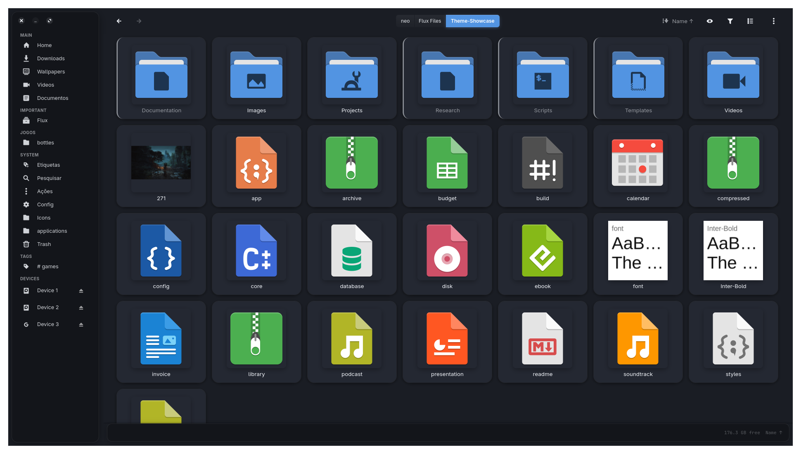

# Flux


Flux is a GTK4/Libadwaita file manager for Linux, written in Rust. It opens instantly, looks at home on GNOME and Wayland, and can be driven from the keyboard.

<p align="center">
  <a href="https://youtu.be/dG7eZXcwW9c">
    
  </a>
</p>

> The icons shown in the screenshot are from [WhiteSur Icon Theme](https://github.com/vinceliuice/WhiteSur-icon-theme) (GPL-3.0).

## Startup time

Cold start on a Ryzen 5 5600X, mean of 10 runs:

| File manager | Startup |
| :----------- | ------: |
| Flux         |  105 ms |
| PCManFM      |  134 ms |
| SpaceFM      |  169 ms |
| Thunar       |  290 ms |
| Nautilus     |  743 ms |

## Features

- **Archives behave like folders.** Open zip, 7z, rar, tar, iso and deb files like any directory, without extracting.
- **Built-in search.** Type to filter the folder, press `Ctrl+F` for a search panel, or start with `:` to search inside files. No index, no background service.
- **Servers and drives.** SMB, SFTP, FTP, WebDAV, NFS, MTP and Google Drive, plus encrypted LUKS volumes.
- **Integrated terminal.** Press `F4`, `cd` somewhere, and the file view follows.
- **Tags.** Label files and find them with `#tag` or `Ctrl+Shift+T`. Tags use the standard `user.xdg.tags` attribute, so they stay with the file.
- **Preview panel.** Images, video, audio, PDFs, code, Markdown, CSV, Office documents and fonts.
- **Custom icons and covers.** Set icons per file type, file or folder, including in bulk from the command line.
- **Show/hide from a keybind.** `flux-fm --toggle`, `--show` and `--hide` control the running window, so one compositor shortcut is enough. `--toggle` and `--show` start Flux if it isn't running.

Press `F1` inside Flux for the full list of shortcuts.

## Grid mode vs list mode

Flux switches to list mode automatically for folders with more items than the **Auto List Mode Threshold** (default 300), which keeps it responsive with several thousand items. Change it in **Settings → Behavior**, or set it to `0` to always use the mode chosen in the header.

## Install

Flux needs GTK 4 and libadwaita 1.5 or newer, so Debian 12 and Ubuntu 22.04 are too old.

### Pre-built AppImage (any distro)

For a quick test without installing anything:

Download the latest from the [Releases page](https://github.com/killown/flux/releases). The AppImage bundles GTK 4 and libadwaita, so it runs on any modern x86_64 Linux.

```bash
chmod +x Flux-x86_64.AppImage
./Flux-x86_64.AppImage
```

### Flatpak (FlatPark)

```bash
flatpak remote-add --if-not-exists flatpark https://dl.flatpark.org/flatpark.flatpakrepo
flatpak install flatpark io.github.killown.flux
```

### Arch (AUR)

```bash
yay -S flux-filemanager-git
```

### From source

Install the dependencies first.

Debian / Ubuntu:

```bash
sudo apt install build-essential cargo fish pkg-config git gettext desktop-file-utils libadwaita-1-dev libgtk-4-dev libpango1.0-dev libgraphene-1.0-dev \
  libcairo2-dev libgdk-pixbuf-2.0-dev libpoppler-glib-dev ffmpeg imagemagick icoutils p7zip-full
```

Fedora:

```bash
sudo dnf install gcc make cargo fish pkgconf-pkg-config git gettext desktop-file-utils libadwaita-devel gtk4-devel pango-devel graphene-devel cairo-devel \
  gdk-pixbuf2-devel poppler-glib-devel ffmpeg ImageMagick icoutils p7zip
```

Arch:

```bash
sudo pacman -S base-devel rust fish git gettext desktop-file-utils libadwaita gtk4 glib2 pango graphene cairo gdk-pixbuf2 poppler-glib \
  ffmpeg imagemagick icoutils ttf-nerd-fonts-symbols p7zip
```

If your distro's Rust is too old to build Flux, install a current toolchain with [rustup](https://rustup.rs) instead.

Then build and install:

```bash
git clone https://github.com/killown/flux.git
cd flux
cargo build --release
make install
```

`make install` installs for the current user into `~/.local` (make sure `~/.local/bin` is in your `PATH`), copies the default menus and helper scripts, and downloads community themes (needs `git` and a connection; skipped offline).

Optional extras:

- **Network browsing:** `gvfs` plus a backend such as `gvfs-smb` or `gvfs-sftp`.
- **LUKS:** `cryptsetup` and `udisks2`.
- **Menu editor icons:** the [Nerd Font symbols](https://github.com/ryanoasis/nerd-fonts/raw/HEAD/patched-fonts/NerdFontsSymbolsOnly/SymbolsNerdFont-Regular.ttf) font in `~/.local/share/fonts`, then `fc-cache -f` (Arch gets it from the package above).
- **Default right-click menu:** some entries call tools such as `alacritty`, `wl-clipboard`, `yt-dlp` or Python with PyGObject. Edit `menu.rs` to match what you have installed.

If you see occasional slow startups, try a lighter icon theme such as Adwaita or refresh your theme's icon cache with `sudo gtk-update-icon-cache -f /usr/share/icons/<theme>`.

## Customization

- Settings live in `~/.config/flux/config.toml`, and most are available in Preferences (`F10`).
- Style the interface with CSS in `~/.config/flux/style.css`: every selector Flux uses is listed with a comment, empty, fill in what you want to change. It reloads when you save. For a full replacement look, drop a theme in `~/.local/share/flux/themes/<name>/theme.css`. See [Theme customization](https://github.com/killown/flux/wiki/Theme-customization).
- Themes go in `~/.local/share/flux/themes`. Community themes are in [flux-themes](https://github.com/killown/flux-themes).
- Right-click menus are defined in `~/.config/flux/menu.rs`, or edit them with the built-in editor (`F9`). `Ctrl+Right-Click` opens a second, file-type-specific menu.
- Set or reset icons in bulk, one `TARGET<TAB>IMAGE` pair per line:

```bash
printf '%s\t%s\n' ~/Videos ~/icons/video.svg ~/Music ~/icons/music.svg | flux-fm --set-icons-stdin
```

## Under the hood

Rust, Relm4 and GTK4, Tokio and Rayon, Nucleo for fuzzy matching, the `ignore` crate for directory walking, and SQLite for tags. 600+ tests (`sh tests.sh`), and the parsers are fuzzed with libFuzzer.

## Contributing

Pull requests are welcome. For big changes, open an issue first, and please run the tests before sending.

## License

[GPLv3](https://github.com/killown/flux/blob/main/LICENSE)
